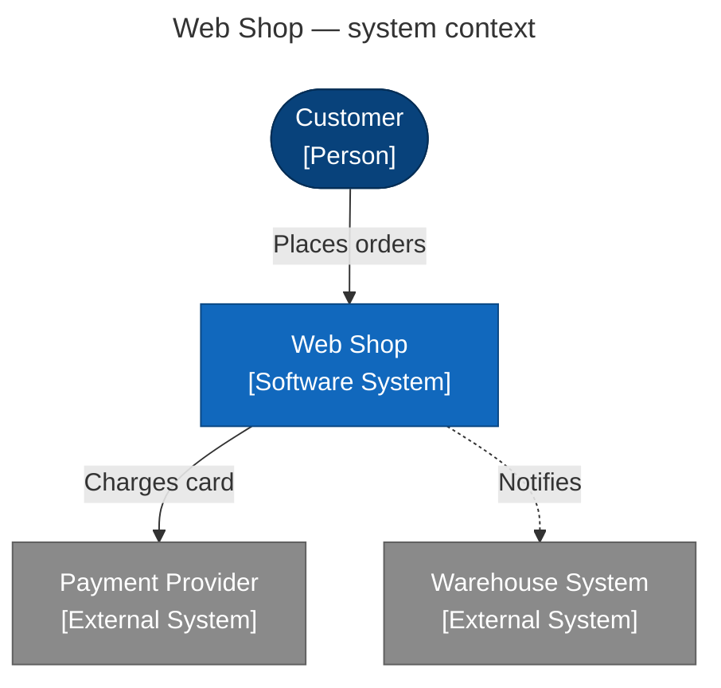
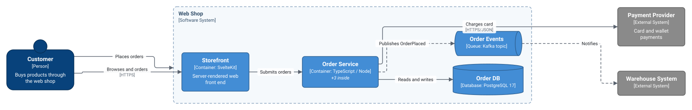
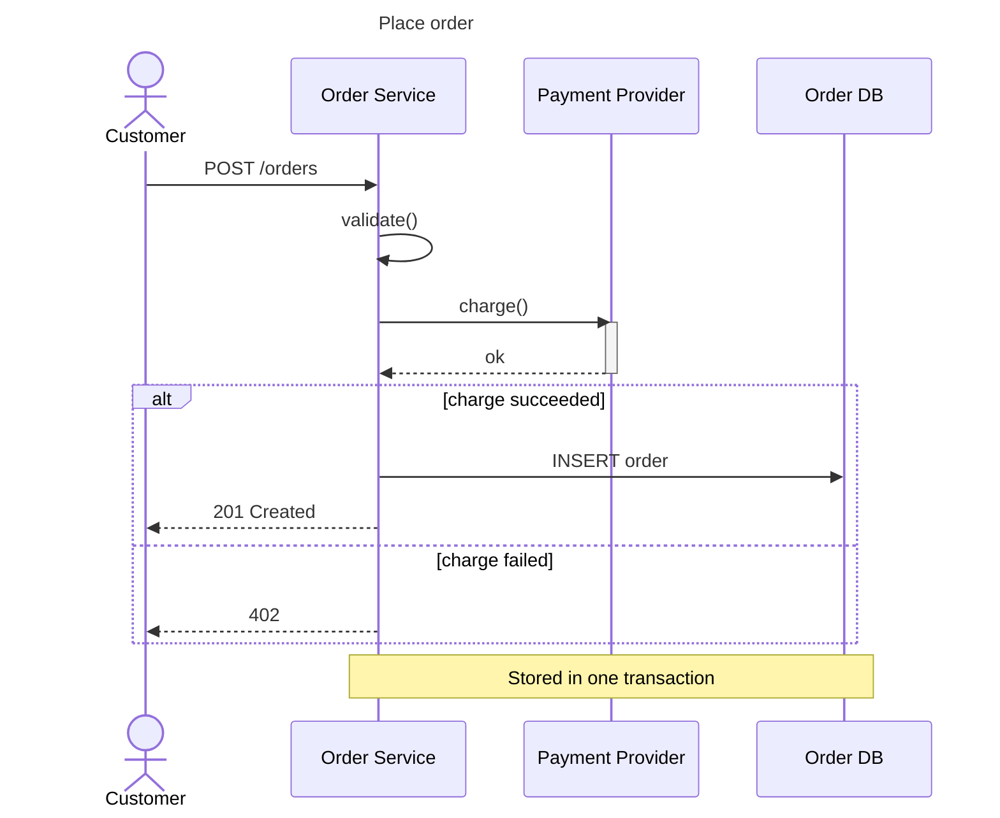
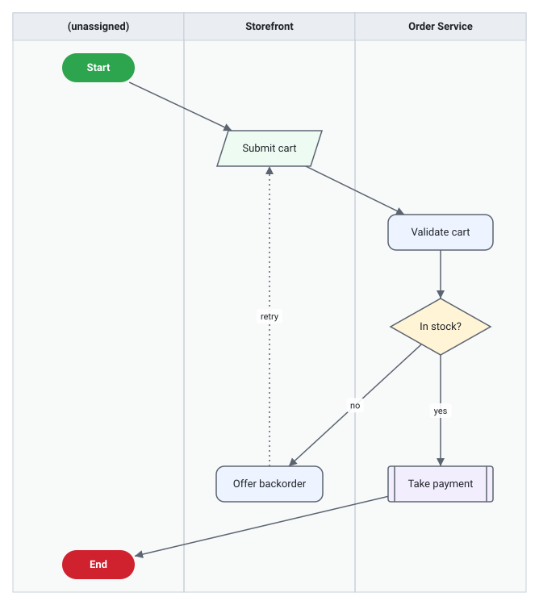

# Web Shop architecture

This page is kept up to date by `sdv md-sync docs/architecture.md`: everything between the
`sdv:view` markers is regenerated from the design model, everything else is hand-written.

## System context

Customers order through the web shop, which charges cards through the payment provider and
notifies the warehouse.

<!-- sdv:view system-context format=mermaid -->

<!-- /sdv:view -->

## Containers

<!-- sdv:view shop-containers format=svg -->

<!-- /sdv:view -->

## Placing an order

<!-- sdv:view place-order format=mermaid -->

<!-- /sdv:view -->

## Checkout flow

<!-- sdv:view checkout-flow format=svg -->

<!-- /sdv:view -->
